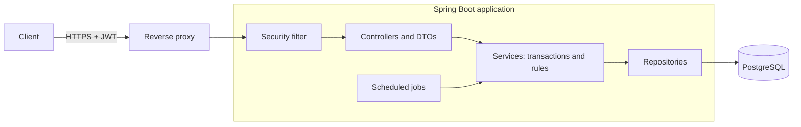
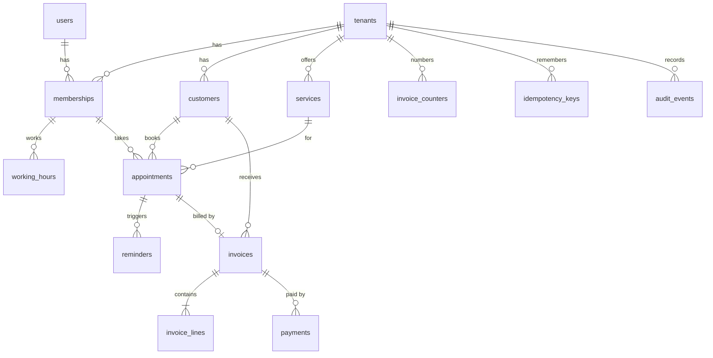

# appointMe

[](https://github.com/kastellosth/appointMe/actions/workflows/ci.yml)

A multi-tenant appointment scheduling and invoicing REST API. Many small businesses (barbers, clinics, tutors) share one system, and each one's data stays isolated.

## What it does

- **Booking:** weekly working hours, free slots in the business's own time zone, and bookings that can't overlap, even under concurrent requests.
- **Invoicing:** a completed appointment creates a draft invoice. Numbers are gapless per business and year, and issued invoices can't be changed.
- **Payments:** a retried request never charges twice, and a row lock prevents overpayment.
- **Audit log:** every business change is recorded in the same transaction, in an append-only table.
- **Reminders:** a scheduled job picks up appointments 24 hours ahead and retries with backoff. Delivery is a logging stub for now, so no real email or SMS is sent.
- **Security:** JWT login, `OWNER` and `STAFF` roles, and tenant isolation enforced in both the code and the database.

## Architecture



## Data model

Every table except `tenants` and `users` belongs to one business through `tenant_id`. Composite foreign keys such as `(tenant_id, customer_id)` make a cross-tenant reference impossible to store.



## Tech stack

Java 21, Spring Boot 4, Spring Security (JWT resource server), Spring Data JPA / Hibernate, PostgreSQL 16, Flyway, springdoc-openapi, JUnit 5, Mockito, Testcontainers, Docker, GitHub Actions.

## Quick start

You need Docker. The first build takes a few minutes.

```bash
git clone https://github.com/kastellosth/appointMe.git
cd appointMe
cp .env.prod.example .env.prod
docker compose -f docker-compose.prod.yml --env-file .env.prod up -d --build
```

Then open <http://localhost:8080/swagger-ui.html>. The example file's values are for trying it on your own machine only. For anything else, follow [docs/deploy.md](docs/deploy.md).

To add a demo business: `bash scripts/demo-seed.sh http://localhost:8080`.

To develop without Docker for the app:

```bash
docker compose up -d
./mvnw spring-boot:run
```

## Design decisions

### Tenant isolation in a shared schema
The main risk of one shared schema is a query that forgets its tenant filter. So there are several layers: the tenant comes only from the signed token, every lookup is tenant-scoped, another tenant's record returns the same 404 as a missing one, and composite foreign keys stop a bad reference even if the Java code is wrong. `TenantIsolationTest` repeats the attacks on every build. See [docs/security-attacks.md](docs/security-attacks.md).

### A database constraint instead of check-then-insert
Two requests can both see a free slot and then both insert. A PostgreSQL exclusion constraint (`EXCLUDE USING gist`) makes that impossible, and it's translated into a 409. In the test, 30 parallel requests for one slot give exactly one 201 and 29 409s. `@Version` wouldn't help, because these are inserts of different rows. See [docs/concurrency.md](docs/concurrency.md).

### Idempotent payments
Networks retry. The client sends an `Idempotency-Key`, and the server claims it with `INSERT ... ON CONFLICT DO NOTHING` in the same transaction as the payment. The same key and body replay the first result, and the same key with a different body gets a 422. See [docs/payments.md](docs/payments.md).

### Time zones and daylight saving
Moments are stored as `TIMESTAMPTZ`. Working hours are wall-clock times in the business's zone, so they're converted for each date. That matters on the two days a year when clocks change, and those days are unit-tested.

### Invoices as immutable records
Invoices follow a state machine: `DRAFT` to `ISSUED` or `VOID`, and `ISSUED` to `PAID` or `VOID`. Prices and tax are copied onto the lines, so later price changes can't alter old invoices, and database triggers freeze issued invoices and payments. See [docs/invoices.md](docs/invoices.md).

### Scheduled jobs that are safe to run twice
`ReminderRunner` claims rows with `FOR UPDATE SKIP LOCKED` and sends outside the transaction. Run with two instances, 200 reminders were each sent exactly once. A crash after sending and before saving can still send a reminder twice, so delivery is at-least-once. See [docs/reminders.md](docs/reminders.md).

### Least-privilege database roles
In production, Flyway runs as the owner role and the application as a role that can only change rows. It can't change the schema or the migration history, and it can't update or delete payments and audit events. See [docs/audit.md](docs/audit.md) and [docs/deploy.md](docs/deploy.md).

## API overview

Full, interactive documentation is at `/swagger-ui.html`.

| Area | Endpoints |
|---|---|
| Auth | `POST /auth/register`, `POST /auth/login`, `POST /auth/select-tenant/{id}`, `GET /auth/me`, `GET /auth/memberships` |
| Business | `POST /tenants`, `GET /tenants/current`, `PUT /tenants/current/billing` |
| Staff | `GET`, `POST /staff`, `GET`, `PUT /staff/{id}/working-hours` |
| Catalogue | CRUD on `/services` and `/customers` |
| Booking | `GET /availability`, `POST`, `GET /appointments`, `PATCH /appointments/{id}/status`, `/cancel`, `/reschedule` |
| Invoices | `POST`, `GET /invoices`, `PUT /invoices/{id}/lines`, `POST /invoices/{id}/issue`, `/void` |
| Payments | `POST`, `GET /invoices/{id}/payments` |
| History | `GET /audit-events`, `GET /reminders` |

Booking, from an empty start:

```bash
# 1. Log in with a registered user, then select a business to get a tenant token
curl -X POST localhost:8080/auth/login -H 'Content-Type: application/json' \
     -d '{"email":"owner@example.com","password":"correct-horse-1"}'
curl -X POST localhost:8080/auth/select-tenant/1 -H "Authorization: Bearer $USER_TOKEN"

# 2. Book. A second request for the same time returns 409.
curl -X POST localhost:8080/appointments -H "Authorization: Bearer $TENANT_TOKEN" \
     -H 'Content-Type: application/json' \
     -d '{"staffId":1,"customerId":1,"serviceId":1,"startsAt":"2030-01-15T10:00:00Z"}'
```

## Testing

```bash
./mvnw verify   # 179 tests. Needs Docker running.
```

| Layer | What it covers |
|---|---|
| Pure unit | Availability (including daylight saving days), money rounding, every invoice status transition |
| Mockito | Decisions inside each service |
| Real PostgreSQL (Testcontainers) | Migrations from empty, SQL, locks, triggers, and parallel booking and payment races |
| HTTP against a real server | The full journey, cross-tenant attacks and role rules |
| Deployed stack | `scripts/smoke-test.sh`, plus attacks on the application's database role |

See [docs/testing.md](docs/testing.md).

## Roadmap

These are real gaps, not extras:

- **Rate limiting** on login and registration. Anyone can register today, and there's no limit on attempts.
- **Real reminder delivery** through an email or SMS provider, instead of the logging stub.
- **Refresh tokens and logout.** A token stays valid until it expires, after 30 minutes.
- **Domain events** (`@TransactionalEventListener`) to separate notifications from the booking code.
- **Row-Level Security** in PostgreSQL as another isolation layer.
- **Automatic backups** and metrics. Backups are a documented manual command today.

## License

[MIT](LICENSE)
